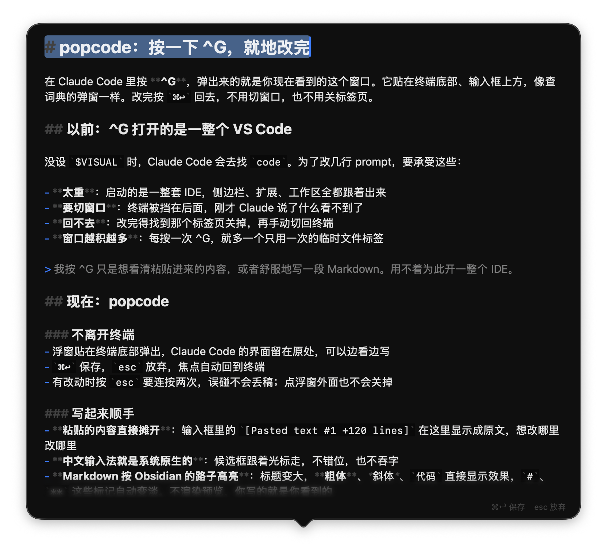

# popcode

A floating, Dictionary-style `$VISUAL` editor for macOS.

Press **Ctrl+G** in Claude Code (or run `git commit`) and a small glass popover appears right above
your terminal's prompt. Edit, press **⌘↩**, and you are back in the terminal — no app switch, no tab
to close.

<p align="center">
  
</p>

## Why

With no `$VISUAL` set, Claude Code's Ctrl+G opens VS Code. For editing a few lines of prompt that means:

- **A whole IDE** starts up — sidebar, extensions, workspace — for one temporary file.
- **You lose the context.** The terminal goes behind another window, so you can't see what Claude
  just said while you write the reply.
- **Getting back is manual.** Close the tab, then switch back to the terminal yourself.
- **Tabs pile up**, one per Ctrl+G.

Most of the time Ctrl+G is just for seeing a collapsed `[Pasted text #1 +120 lines]` in full, or for
writing Markdown more comfortably than in a TUI input box. That shouldn't take an IDE.

## What you get

**Stays out of the way**
- Pops up over the bottom of the terminal window; Claude Code's TUI stays visible behind it.
- **⌘↩** / **⌘S** save and close, **Esc** discards; focus returns to the terminal.
- Esc needs a second press when there are changes, and clicking outside never closes it, so a
  draft can't be lost by accident.

**Nice to write in**
- Pasted text that Claude Code collapses shows up in full and is editable.
- Native macOS text input: CJK input methods with a correctly placed candidate window, undo,
  ⌘F find, and the usual Ctrl+A / Ctrl+E bindings.
- Obsidian-style Markdown source highlighting for `.md` files: larger headings, **bold**,
  *italic*, `code`, with the `#` / `**` markers dimmed. No rendered preview — what you type is
  what you see.

**Polished details**
- The popover grows with the text; past its maximum height the text scrolls under soft
  fade-and-blur edges.
- A smooth caret that glides like VS Code's Smooth Caret Animation.
- Rounded, connected selection shapes that grow top-down or bottom-up, and smooth autoscroll when
  drag-selecting past an edge.
- The shell is a system `NSPopover`, so dark mode and Liquid Glass come from macOS itself.

**Small**
- A single command-line binary built with SwiftPM + AppKit, no third-party dependencies.

## Requirements

macOS 26 or later.

## Install

### From a release

Download `popcode-<version>-macos-universal.tar.gz` from
[Releases](https://github.com/is52hertz/popcode/releases), then:

```sh
tar -xzf popcode-*-macos-universal.tar.gz
mv popcode ~/.local/bin/          # or anywhere on your PATH
xattr -d com.apple.quarantine ~/.local/bin/popcode   # the binary is not notarized
```

### From source

```sh
git clone https://github.com/is52hertz/popcode.git
cd popcode
swift build -c release
ln -sf "$PWD/.build/release/popcode" ~/.local/bin/popcode
```

### Make it your editor

In `~/.zshrc` (skipped over SSH, where there is no GUI to pop up):

```sh
[[ -z $SSH_CONNECTION ]] && export VISUAL=popcode
```

Open a new terminal and press Ctrl+G in Claude Code.

## Keys

| Key | Action |
| --- | --- |
| ⌘↩ / ⌘S | Save and close |
| Esc | Close without saving (press twice if there are changes) |
| ⌘F | Find |
| ⌘Z / ⇧⌘Z | Undo / redo |

## How it plugs in

popcode follows the standard blocking-editor contract: it is run as `popcode <file>`, and exits
with status 0 once you save or discard. Claude Code writes the prompt to a temporary `.md` file
(with pasted text expanded) and reads it back when the editor exits.

Keep `code` in the binary's name. Claude Code treats editors whose names contain `code` as GUI
editors: it keeps the TUI on screen while the editor is open and passes `-g <file>:<line>`, which
popcode uses to place the caret where it was in the prompt.

## License

[MIT](LICENSE)
